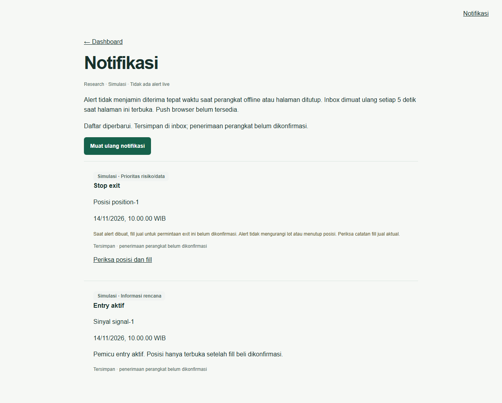
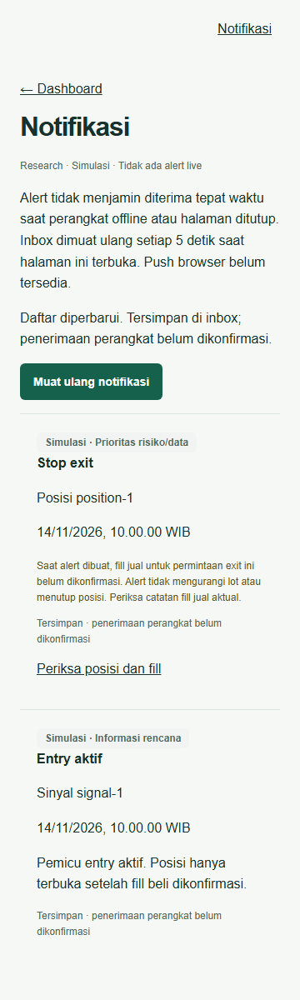

# SS-022 — Alert in-app

Halaman `/alerts` menampilkan inbox akun/mode sesi melalui `GET /api/v1/alerts`.
Semua contoh adalah simulasi research. Dependency #5/#12/#15/#21 sudah selesai;
G0–G3 belum lulus dan jalur alert live tidak diaktifkan.

## Semantik dan sumber

| Jenis | Sumber | Prioritas |
| --- | --- | --- |
| ENTRY_READY | READY terbaru yang belum kedaluwarsa dan kualitas sehat | 4 |
| INVALIDATED | Versi sinyal CANCELLED/EXPIRED | 2 |
| STOP / TP | Permintaan exit STOP/TARGET yang dikonfirmasi pengguna | 0 / 1 |
| TIME_EXIT | Tenggat rencana pada posisi dengan lot tersisa | 1 |
| PLAN_CHANGED | Isi rencana posisi berubah | 3 |
| DATA_DISCONNECTED | Kualitas fixture tidak sehat; adapter episode SS-012 | 0 |

Angka lebih kecil diprioritaskan. Harga chart tidak digunakan untuk mengarang
entry, sentuhan stop/target, order atau fill. Pada fixture, kualitas tidak tersedia
menahan ENTRY_READY; UI tidak membuat contoh entry aktif sebagai sinyal tervalidasi.
Inbox menyimpan identitas sinyal/posisi; pesan exit menjelaskan bahwa saat dibuat,
fill jual untuk permintaan tersebut belum dikonfirmasi. Riwayat alert tidak berubah
setelah SELL; pengguna memeriksa ledger posisi untuk kondisi terkini.

`AlertEvent` adalah batas aplikasi internal, bukan endpoint penerbitan pengguna.
`feed_event(PositionDataDisruption)` mempertahankan sumber/simbol/posisi/episode
SS-012, mode dan origin; retry episode sama dideduplikasi, episode baru dapat memberi
peringatan baru. Integrasi vendor/worker live masih memerlukan gerbang dan wiring
runtime terkait. Fixture memakai identitas gangguan tetap karena tidak pernah pulih.

## Persistensi dan retry

Jalankan migrasi eksplisit dari `services/api`:
`uv run --locked python -m saham_signal.migrate`. Migrasi `004_alerts.sql` menambah
`in_app_alerts` append-only dan `alert_gates` untuk state kebijakan. Role runtime perlu
SELECT/INSERT pada inbox, SELECT/INSERT/UPDATE pada gates, dan USAGE sequence inbox.
RLS paksa, CHECK scope serta verifikasi nama database memisahkan akun/mode.

Advisory lock per akun/mode menserialisasi proses; UNIQUE
`(mode,user_id,source_key,channel)` dan ID SHA-256 stabil memastikan satu record per
event/kanal. Browser mengganti snapshot dan memakai dedup key; retry, reload dan
reconnect tidak menambahkan salinan. History tetap di database meskipun respons
hilang. Tidak ada fallback memori ketika database gagal (HTTP 503).

Command posisi PostgreSQL dan alert yang dihasilkannya disimpan dalam satu transaksi,
sehingga permintaan stop/target tetap tercatat walau browser tertutup atau posisi
kemudian dijual. Polling mengevaluasi tenggat yang telah lewat dan expiry fixture.
Tidak ada scheduler latar belakang untuk tenggat: evaluasi berikutnya dapat terlambat
sampai ada command posisi atau polling. Polling bukan jaminan batas latensi PRD.

READY harus teramati stabil selama 3 detik. Observasi nonaktif mereset stabilitas;
episode entry berikutnya menunggu cooldown 30 detik. Perubahan rencana kecil memakai
cooldown 30 detik, versi terbaru dapat tampil pada refresh setelah cooldown.
Risiko/data melewati penundaan ini. Nilai ini provisional dan memerlukan evaluasi
terpisah. Gates bertahan setelah restart. Event replay tidak diterbitkan; mode event
harus sama dengan mode inbox, simulasi tidak masuk live, market tidak masuk research.

Kontrak `Alert`/`AlertsResponse` v1 tetap identik. `pending` dan `delivered_at: null`
berarti record tersedia di server, bukan bukti perangkat menerima/membaca pesan.
Belum ada ACK perangkat atau receipt push. Query inbox membatasi 1000 record dengan
prioritas risiko/data dahulu; pagination/retensi berikutnya diperlukan untuk pilot
bervolume tinggi. Tidak ada penghapusan otomatis.

## Browser dan offline

Halaman memuat ulang inbox setiap 5 detik ketika terbuka, serta segera saat event
`online`. Request timeout 10 detik; request lama dibatalkan dan tidak boleh menimpa
hasil baru. Offline/gagal jaringan mempertahankan daftar terakhir dengan penanda
bahwa data mungkin tertinggal. Mode/kontrak salah ditolak. Tidak ada toast berulang,
push browser, permission request, atau service worker pengiriman latar belakang.
Peringatan keterbatasan offline/halaman tertutup selalu terlihat.

## Verifikasi

- Backend: seluruh tipe alert sesuai schema, replay/provenance/mode, feed episode,
  hysteresis/reset/cooldown, prioritas, expiry, auth, retry dan input ditolak.
- PostgreSQL di CI: race lintas koneksi, restart, idempotensi, akun/RLS/mode,
  trigger append-only, gate persisten, dan stop yang tersimpan atomik sebelum SELL
  penuh saat browser tertutup.
- Chromium: urutan risiko, pesan exit, retry/reload, offline/reconnect, respons mode
  salah, recovery/kosong, viewport 360px dan target sentuh 44px.

