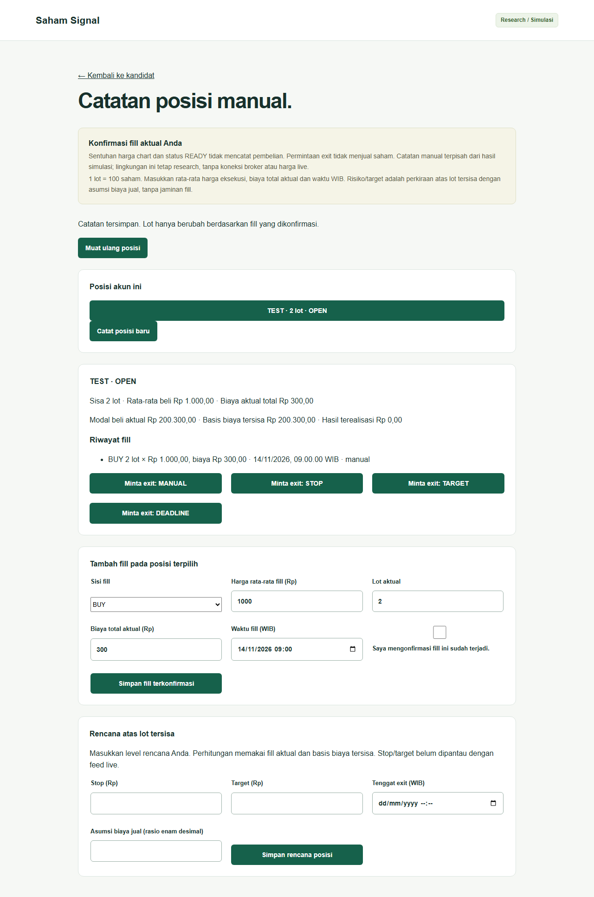
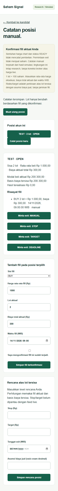

# Pencatatan fill dan posisi manual (SS-021)

Halaman `/positions`, ditautkan dari dashboard, mencatat harga rata-rata eksekusi,
lot aktual, biaya total aktual dan waktu WIB atas konfirmasi eksplisit pengguna.
Setiap fill baru wajib dikonfirmasi kembali; form tidak menganggap chart/READY
sebagai pembelian atau permintaan exit sebagai penjualan. Input tidak mengirim
order ke broker. Semua contoh/screenshot adalah data sintetis di lingkungan research.

## Penyimpanan dan API

Jalankan migrasi seperti panduan API: dari `services/api`,
`uv run --locked python -m saham_signal.migrate`. Migrasi `003_manual_positions.sql`
menambah ledger append-only terpisah dari hasil replay/simulasi, dengan RLS paksa
per akun/mode, pemeriksaan scope dan trigger penolak UPDATE/DELETE/TRUNCATE.
Snapshot menyimpan fill, rencana, versi dan biaya; setiap command disimpan bersama
hasilnya dalam satu transaksi dengan advisory lock per akun/mode. Restart API
membaca ledger PostgreSQL yang sama; DB gagal menghasilkan 503, tanpa fallback memori.

| Endpoint `/api/v1` | Perilaku |
| --- | --- |
| `GET /positions` | Daftar posisi manual akun/mode sesi |
| `POST /positions` | `OpenPositionRequest`, BUY pertama; `signal_id: null` pada fixture |
| `GET /positions/{id}` | Posisi dan seluruh fill |
| `POST /positions/{id}/fills` | `FillRequest` BUY tambahan atau SELL parsial/penuh |
| `GET /positions/{id}/monitor` | Posisi, rencana, modal aktual, basis biaya dan hasil terealisasi |
| `PUT /positions/{id}/plan` | Stop, target, tenggat UTC dan asumsi rasio biaya jual eksplisit |
| `POST /positions/{id}/exit-request` | Alasan MANUAL/STOP/TARGET/DEADLINE; tidak mengurangi lot |

Mutasi membutuhkan Origin yang diizinkan dan `Idempotency-Key` (1–128 karakter).
Key unik per akun/mode di seluruh command; retry identik mengembalikan snapshot
semula, isi berbeda menghasilkan 409. Browser mempertahankan key pada retry payload
identik setelah timeout/respons hilang dan mengunci submit selama proses berjalan.
Identitas dan mode berasal dari sesi server, bukan input pengguna. Cookie fixture
SS-017 tetap digunakan; autentikasi pilot penuh masih SS-023.

Kontrak Position/Fill/OpenPositionRequest/FillRequest lama tetap identik.
Endpoint monitor/plan/exit memakai definisi tambahan. Envelope berlabel simulation
menggambarkan lingkungan research dan kualitas feed; fill `origin: manual`
membedakan konfirmasi pengguna dari fill `simulation`. UI menolak fill simulasi
sebagai catatan manual. Tidak ada agregasi hasil manual dengan hasil replay dan
belum ada aktivasi jalur live/paper produksi.

## Perhitungan dan status

- 1 lot = 100 saham, cakupan saham BEI standar. Produk/lot khusus dan aksi korporasi
  belum didukung; bukan master instrumen produksi.
- Modal aktual = seluruh nilai BUY + biaya aktual BUY, tanpa memakai nominal rencana.
  Rata-rata beli berbobot menggunakan jumlah saham aktual; SELL mengalokasikan basis
  biaya tersisa secara proporsional. Biaya aktual setiap SELL mengurangi hasilnya.
- Decimal presisi 80 dipakai untuk basis/hasil internal; pembulatan dua desimal hanya
  pada tampilan. Partial exit berulang tidak kehilangan pecahan biaya dan penutupan
  penuh menyisakan basis nol. Nilai turunan divalidasi sebelum commit.
- Stop loss = maksimum nol dari basis biaya tersisa dikurangi nilai exit di stop
  setelah asumsi biaya jual. Target bersih = nilai exit di target setelah asumsi
  biaya jual dikurangi basis biaya tersisa; dapat negatif bila biaya tinggi.
  Asumsi ini tidak mencakup slippage, gap, antrean, gagal exit atau jaminan risiko.
- OPEN setelah BUY; PARTIAL setelah SELL yang masih menyisakan lot; EXIT_REQUESTED
  setelah permintaan exit atau tenggat rencana terlewati; CLOSED hanya setelah
  seluruh lot terkonfirmasi dijual. Partial SELL saat exit pending tetap pending.
- Fill berurutan secara waktu dan tidak boleh di masa depan. Oversell dan perubahan
  posisi CLOSED ditolak; BUY tambahan saat exit pending ditolak. Koreksi historis,
  pembatalan atau impor broker belum termasuk cakupan ini.
- Stop/target diberikan pengguna, bukan disalin dari model fixture yang belum
  tervalidasi. Pemicu STOP/TARGET dikonfirmasi manual karena tidak ada feed live
  sehat. Tenggat diproyeksikan deterministik tanpa menciptakan fill jual.
- Risiko overnight tampil jika lot tersisa melewati hari pembelian di WIB atau
  mulai 15.30 WIB. Ini peringatan konservatif, bukan kalender/cutoff bursa tervalidasi.
  Halaman memuat ulang status tiap 30 detik dan menyediakan tombol muat ulang.

## Bukti acceptance

Tes backend memastikan chart tidak membuka posisi, partial fill tidak memakai
seluruh nominal, stop tanpa jual tetap terbuka, partial exit/biaya/PnL, deadline,
validasi, retry, akun/mode dan outage. Tes PostgreSQL menguji restart, concurrent
submit/exit, RLS dan append-only; memerlukan `PERSISTENCE_TEST_DSN` disposable
seperti tes SS-010 dan dijalankan oleh CI infrastruktur.

Tes Chromium mencakup konfirmasi BUY, exit tanpa jual, partial SELL, reload, retry
respons hilang dengan key sama, kegagalan load dan lebar 360px tanpa overflow.

G0/G1/G2/G3 tetap memerlukan bukti tersendiri. Implementasi ini bukan integrasi
broker, feed berizin, rekomendasi transaksi atau bukti performa strategi.
