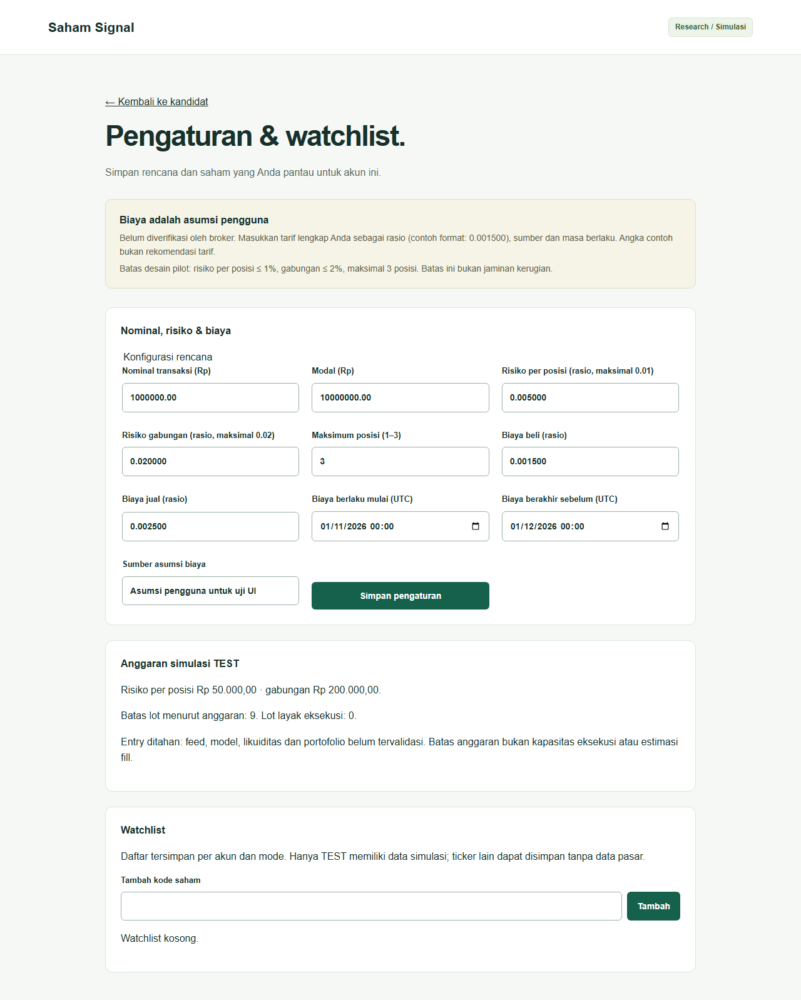
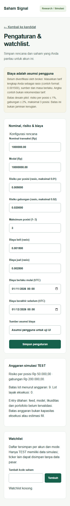

# SS-020 — Watchlist dan pengaturan pribadi

Watchlist, nominal, modal, batas risiko dan asumsi biaya tersedia melalui halaman
`/settings`. Seluruh market output masih **research / simulasi**, tanpa feed,
model tervalidasi, klaim tarif broker terverifikasi, atau izin melewati G0–G3.
Dependency SS-010, SS-017 dan SS-018 telah tersedia.

## Setup dan penyimpanan

Ikuti setup API dan PostgreSQL di [panduan API](../../services/api/README.md) dan
[infra](../../infra/README.md). Jalankan migrasi eksplisit sebelum menggunakan UI:
`uv run --locked python -m saham_signal.migrate` dari `services/api`.
Migrasi `002_preferences.sql` menambahkan snapshot personal append-only dengan
RLS paksa, akun/mode, waktu pencatatan, lock per akun dan idempotensi.
API tidak membuat tabel otomatis dan tidak beralih ke penyimpanan memori saat
database gagal. Kegagalan database menghasilkan 503 dan UI tidak menimpa daftar
yang belum berhasil dimuat.

Aktifkan fixture research dan cookie HttpOnly sesuai [panduan market API](market-api.md).
Identitas berasal dari sesi fixture dan `PILOT_ACCOUNT_ID` server, bukan query/body.
Satu deployment fixture melayani satu akun pilot; pengujian memakai dua aplikasi
bersesi berbeda dan penyimpanan bersama untuk membuktikan isolasi. Autentikasi
pilot penuh tetap bagian SS-023. Tidak ada akses paper/live pada fixture ini.

## Endpoint dan kontrak

| Endpoint | Perilaku |
|---|---|
| GET/PUT `/api/v1/watchlist` | Payload `Watchlist`, respons `WatchlistResponse`; kosong sah, maksimal 200 ticker unik. |
| GET/PUT `/api/v1/settings/profile` | `RiskProfile`/`RiskProfileResponse`, menyimpan risiko dan biaya lengkap secara atomik. GET 404 jika belum diatur. |
| GET/PUT `/api/v1/settings/risk` | Bentuk v1 `RiskSettings` tetap utuh. PUT mengacu pada biaya profil yang sudah disimpan; versi biaya yang tidak dikenal ditolak. |
| GET `/api/v1/settings/eligibility` | `SettingsEligibilityResponse`, dihitung ulang dari profil terkini dan jam server. GET 404 jika belum diatur. |

`RiskProfile`, `UserFeeSchedule` dan `SettingsEligibility` merupakan definisi untuk
endpoint baru. Objek v1 lama tidak ditambah field. PUT memerlukan Origin yang
diizinkan dan `Idempotency-Key` 1–128 karakter. Key berulang dengan payload sama
mengembalikan hasil asli tanpa mengaktifkan kembali konfigurasi lama; key yang
dipakai untuk payload berbeda menghasilkan 409. Versi konfigurasi tidak boleh
dipakai ulang; versi biaya tidak boleh diganti isinya. Respons personal private,
no-store dan Vary Cookie; CSRF lintas origin ditolak.

Uang wajib string dua pecahan, rasio enam pecahan; tidak ada float accounting.
Nominal/modal harus positif dan nominal ≤ modal. Batas desain pilot mengikuti
SS-015: `0 < risiko per posisi ≤ 0.01`, risiko per posisi ≤ risiko gabungan ≤ 0.02,
dan 1–3 posisi. Batas tersebut bukan rekomendasi investasi atau jaminan kerugian.
Biaya wajib memiliki versi yang sama dengan `fee_schedule_version`, rasio beli/jual
0–1, sumber, interval UTC `[effective_from,effective_to)` yang terurut dan label
`verification: user_assumption`. Tidak ada nilai tarif default di form. Tarif masa
depan/lampau dapat disimpan untuk pencatatan tetapi tidak memberi kelayakan saat ini.
Field asing, akun/mode buatan klien, ticker duplikat dan input invalid ditolak.

## Perhitungan ulang dan keterbatasan

Setiap pembacaan kandidat/detail/history/stream mengambil konfigurasi akun terbaru;
cache dipisahkan menurut akun, mode, nominal, horizon dan versi konfigurasi.
Penulisan menghapus cache akun tersebut saja. Cache proses lain tetap aman karena
versi konfigurasi immutable dibaca dari PostgreSQL pada permintaan berikutnya.
Nominal tersimpan menjadi sumber utama; dashboard menautkan perubahan ke pengaturan.
Dashboard tanpa profil masih mengizinkan nominal sementara sesuai SS-018. Perubahan
profil di tab lain yang tidak cocok dengan nominal UI ditolak validator kandidat;
muat ulang dashboard untuk memuat profil baru.

Evaluasi **khusus skenario sintetis TEST** menghitung budget = modal × rasio risiko,
serta batas lot menurut kas dan kerugian pada stop memakai Decimal. Harga upper entry
1010, stop 990 dan 100 saham/lot berasal dari skenario TEST, bukan aturan instrumen
produksi. Biaya proporsional beli/jual masuk perhitungan. Ini batas anggaran sebelum
slippage, likuiditas, reservasi posisi lain dan fee minimum/pajak broker yang lebih
kompleks; bukan hasil engine eksekusi SS-015 atau estimasi fill.
Biaya di luar masa berlaku menghasilkan batas nol. `eligible_lots` selalu nol dan
sinyal tetap WATCH/EXPIRED karena feed/model belum tervalidasi; tidak ada probabilitas
atau likuiditas buatan. Portfolio/fill dan aktivasi produksi tetap pekerjaan terpisah.

## Validasi dan tampilan

Tes backend mencakup sesi, dua akun, RLS, restart repository, snapshot append-only,
idempotensi, versi immutable, invalid input, masa berlaku biaya serta perubahan
nominal/risiko/biaya. Tes browser mencakup form kosong, simpan/reload, perubahan
dashboard, tambah/hapus/duplikat ticker, gangguan load/save dan viewport 360px.
Tes PostgreSQL memerlukan `PERSISTENCE_TEST_DSN`; CI backend menyediakan database
disposable dan menjalankan tes tersebut.

